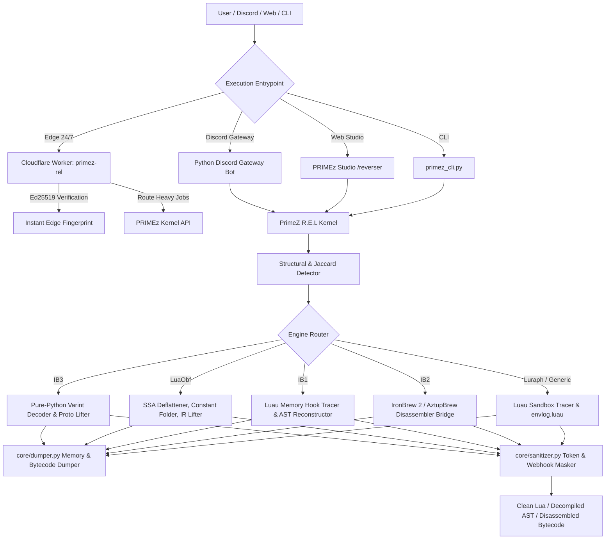

# ⚡ PrimeZ R.E.L (Reverse Engineering Lua)
## Comprehensive Technical & Architecture Documentation

> **PrimeZ R.E.L** stands for **Reverse Engineering Lua**.  
> It is an enterprise-grade, multi-engine reverse engineering framework, autonomous deobfuscator, and constant/bytecode memory dumper for Lua and Luau scripts. Built natively into the **PRIMEz Suite** alongside VYKUS Obfuscator.

---

## 📑 Table of Contents

1. [System Architecture](#1-system-architecture)
2. [Supported Engines & Pipelines](#2-supported-engines--pipelines)
3. [Dual Operations: Deobfuscator vs. Dumper](#3-dual-operations-deobfuscator-vs-dumper)
4. [24/7 Cloudflare Worker Edge Integration](#4-247-cloudflare-worker-edge-integration)
5. [Discord Bot Deployment & Slash Commands](#5-discord-bot-deployment--slash-commands)
6. [Web Studio Workbench (PRIMEz Suite)](#6-web-studio-workbench-primez-suite)
7. [CLI Reference & Automation](#7-cli-reference--automation)
8. [API Reference & Schema](#8-api-reference--schema)
9. [Security, Privacy & Webhook Masking](#9-security-privacy--webhook-masking)
10. [Troubleshooting & FAQ](#10-troubleshooting--faq)

---

## 1. System Architecture

PrimeZ R.E.L uses a hybrid, multi-tier architecture to handle everything from microsecond edge signature checks to deep AST devirtualization:



---

## 2. Supported Engines & Pipelines

PrimeZ R.E.L integrates 5 specialized engines to handle different obfuscation layers and VM architectures:

### 🔹 Engine 1: IronBrew 3 (IB3)
- **Module**: `engines/ib3/deserializer.py`
- **Technique**: Pure Python bytecode deserialization.
- **Capabilities**:
  - Unpacks 7-bit encoded LEB128 varints and dynamic opcode maps.
  - Recursively reconstructs top-level and nested prototypes (`Proto`).
  - Dumps string constants, numerical pools, and opcode arrays into structured JSON or readable Lua.

### 🔹 Engine 2: LuaObfuscator (Ferib SSA Lifter)
- **Module**: `engines/luaobf/`
- **Technique**: Static Single Assignment (SSA) and Control Flow Graph (CFG) lifting.
- **Capabilities**:
  - **Deflattener**: Flattens nested state-machine loops (`while true do if state == 1 then ... end`) back into sequential logic.
  - **Constant Folding**: Evaluates static arithmetic, string concatenations, and bitwise operations at compile time.
  - **Dead Code Elimination**: Prunes opaque predicates and unreachable jump branches.

### 🔹 Engine 3: IronBrew 1 (IB1)
- **Module**: `engines/ib1/runner.py`
- **Technique**: Dynamic memory hook injection via `luau.exe`.
- **Capabilities**:
  - Injects runtime closure maker hooks (`capture.luau`).
  - Intercepts VM dispatch tables and extracts live bytecode instructions from memory.
  - Devirtualizes VM loops back into high-level AST representations.

### 🔹 Engine 4: IronBrew 2 / AztupBrew (IB2)
- **Module**: `engines/ib2/bin/CLI.exe`
- **Technique**: High-performance native disassembler.
- **Capabilities**:
  - Bridges IronBrew 2 and AztupBrew bytecodes.
  - Dissolves multi-layer encryption keys and outputs formatted Lua opcode listings.

### 🔹 Engine 5: Luraph v14.7 – v15 & Generic Sandbox
- **Module**: `engines/luraph/deob.py` & `engines/luraph/envlog.luau`
- **Technique**: Isolated Luau sandbox with simulated Roblox & executor environment.
- **Capabilities**:
  - Traps Roblox environment probes (e.g., `Path2D`, `Vector3`, `UDim2`, datatype math).
  - Emulates executor APIs (`getgenv`, `hookfunction`, `request`, etc.).
  - Reconstructs script behavior from execution traces when static devirtualization is blocked.

---

## 3. Dual Operations: Deobfuscator vs. Dumper

PrimeZ R.E.L provides two complementary operational modes:

| Feature | Deobfuscator Mode (`/deobf`) | Bytecode & Constant Dumper Mode (`/dump`) |
| :--- | :--- | :--- |
| **Primary Goal** | Reconstruct readable, working Lua source code. | Extract raw data pools, strings, webhooks, and opcodes. |
| **AST Recovery** | Full AST devirtualization & control-flow restructuring. | Fast parsing of constant tables and instruction streams. |
| **Use Case** | Understanding script logic, auditing scripts, modding. | Forensic analysis, extracting hidden URLs, credentials, payloads. |
| **Output Format** | Clean Lua / Luau file. | Formatted constants dump + bytecode disassembly file. |

---

## 4. 24/7 Cloudflare Worker Edge Integration

The Cloudflare Worker allows the bot and API to be **live 24/7 with zero hosting fees, zero servers to maintain, and globally distributed edge latency (<15ms)**.

### Deployment Details
- **Live Worker URL**: `https://primez-rel.primez-hub.workers.dev`
- **Account ID**: `c744ddf2a5e5e69a9de254ee0546789b`
- **Origin Routing**: `https://primez-studios.onrender.com`

### How It Works 24/7 for Discord:
Discord supports **HTTP Interactions Endpoints**. When configured:
1. Discord delivers slash commands directly to the Cloudflare Worker via HTTP POST.
2. The Worker verifies the **Ed25519 signature** (`crypto.subtle.verify`) using your application's Public Key.
3. Edge tasks (e.g., health diagnostics, instant obfuscator fingerprinting) respond immediately from the Edge.
4. Heavy decompilation tasks are queued or forwarded to the backend cluster (`https://primez-studios.onrender.com`).

#### Step-by-Step 24/7 Discord Configuration:
1. Go to [Discord Developer Portal](https://discord.com/developers/applications/1569712748575723562/information).
2. Under **General Information**, find **INTERACTIONS ENDPOINT URL**.
3. Enter:
   ```text
   https://primez-rel.primez-hub.workers.dev/interactions
   ```
4. Click **Save Changes**. Discord will ping the URL with a `PING` payload (`type: 1`), and the worker will instantly respond with `PONG` (`type: 1`).

---

## 5. Discord Bot Deployment & Slash Commands

### Bot Credentials & Setup
- **Application ID**: `1569712748575723562`
- **Public Key**: `f3f27f62b5efbd0c758d0fb7adfa053a02a5f7afca029f00e45e18baf8d2887e`
- **Invite Link**: [Add PrimeZ R.E.L to Discord Server](https://discord.com/oauth2/authorize?client_id=1569712748575723562&scope=bot%20applications.commands&permissions=277025770560)

### Registered Slash Commands
- **`/deobf`**
  - *Parameters*: `file` (attachment), `code` (string), `backend` (`auto`, `ib1`, `ib2`, `ib3`, `luaobf`, `luraph`)
  - *Action*: Deobfuscates code and returns both an embed summary and downloadable `.lua` file.
- **`/dump`**
  - *Parameters*: `file` (attachment), `code` (string)
  - *Action*: Extracts all string literals, numbers, table constants, and disassembled opcodes.
- **`/detect`**
  - *Parameters*: `file` (attachment), `code` (string)
  - *Action*: Analyzes entropy, opcodes, and fingerprints to identify the exact obfuscator.
- **`/status`**
  - *Action*: Runs real-time diagnostics on all 5 engines and reports binary health.

---

## 6. Web Studio Workbench (PRIMEz Suite)

PrimeZ R.E.L is directly integrated into the official PRIMEz Studio web interface:
- **Studio Route**: `https://primez-studios.onrender.com/reverser`
- **Features**:
  - Dual-pane live code workbench (Obfuscated input on left, Deobfuscated/Dump output on right).
  - One-click **Detect Fingerprint** with confidence bar.
  - Interactive backend selector (Auto, IronBrew 1/2/3, LuaObfuscator, Luraph).
  - Quick action buttons: **Deobfuscate Script**, **Dump Constants & Bytecode**, **Copy Clean Output**, **Download .lua**.
  - Integrated navigation with VYKUS Obfuscator.

---

## 7. CLI Reference & Automation

The CLI tool `primez_cli.py` can be used locally or in CI/CD pipelines:

```bash
# Auto-detect and deobfuscate to file
python primez_cli.py obfuscated.lua -o deobfuscated.lua

# Dump constants and disassembled bytecode
python primez_cli.py obfuscated.lua --dump -o constants_dump.txt

# Fingerprint analysis with JSON output
python primez_cli.py --detect obfuscated.lua --json

# Force a specific engine
python primez_cli.py protected.lua --backend ib3 -o output.lua
```

---

## 8. API Reference & Schema

### `GET /health`
Returns edge worker and cluster health:
```json
{
  "status": "operational",
  "service": "PrimeZ R.E.L (Reverse Engineering Lua)",
  "capabilities": ["deobfuscator", "bytecode_dumper", "memory_tracer", "fingerprinter"],
  "timestamp": "2026-11-10T14:32:33.697Z"
}
```

### `POST /api/reverser/detect`
**Request Body**:
```json
{
  "source": "-- obfuscated lua code here"
}
```
**Response Body**:
```json
{
  "name": "IronBrew 3",
  "kind": "ib3",
  "confidence": 99
}
```

### `POST /api/reverser/deobf`
**Request Body**:
```json
{
  "source": "-- code",
  "backend": "auto",
  "sanitize": true
}
```
**Response Body**:
```json
{
  "success": true,
  "source": "-- Deobfuscated Lua code\nprint('Hello World')",
  "backend_used": "ib3",
  "duration_sec": 0.42
}
```

---

## 9. Security, Privacy & Webhook Masking

To protect users and developers from credential exposure, PrimeZ R.E.L automatically routes all deobfuscated outputs through the **Security Shield** (`core/sanitizer.py`):
- **Discord Webhooks**: Masked to `https://discord.com/api/webhooks/[REDACTED_WEBHOOK]`
- **Bot Tokens**: Matched against standard 59-72 character Discord token patterns and masked to `[REDACTED_DISCORD_TOKEN]`
- **Sandbox Isolation**: The Luau sandbox intercepts all environment variables and denies direct network sockets.

---

## 10. Troubleshooting & FAQ

**Q: Can Cloudflare Worker keep the bot running 24/7 if my PC is turned off?**  
**A:** Yes! When Discord's **Interactions Endpoint URL** points to `https://primez-rel.primez-hub.workers.dev/interactions`, Cloudflare handles slash commands around the clock on edge servers.

**Q: What if a script uses a custom or unknown obfuscator?**  
**A:** Select the **Generic Sandbox** backend. PrimeZ R.E.L executes the script inside an instrumented Luau sandbox (`envlog.luau`), logs all environment and state manipulations, and outputs a clean behavioral trace.

**Q: Where can I report issues or suggest new engine plugins?**  
**A:** Join the official **[PRIMEz Studios Discord Server](https://discord.gg/primez)** or open an issue on the repository.
